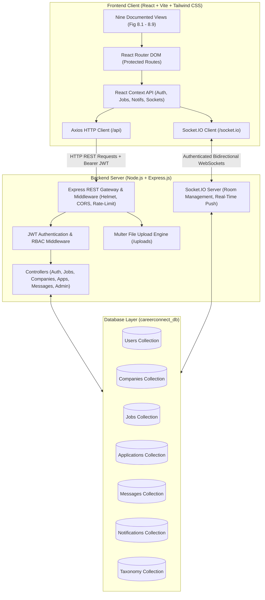
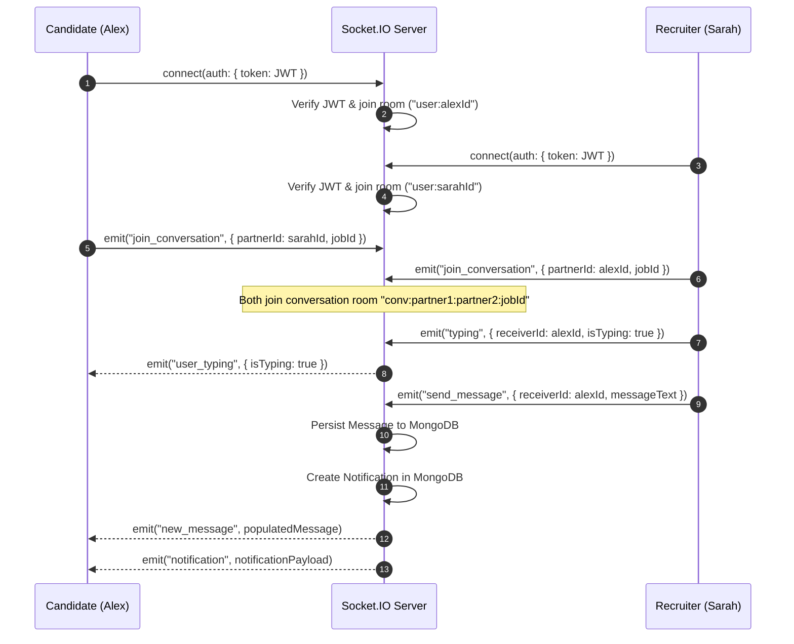

# CareerConnect — Full-Stack Job Portal & Talent Marketplace

[](https://nodejs.org/)
[](https://react.dev/)
[](https://expressjs.com/)
[](https://www.mongodb.com/)
[](https://socket.io/)
[](https://tailwindcss.com/)
[](LICENSE)

CareerConnect is an enterprise-grade, comprehensive full-stack job portal web application that connects job seekers with employers and recruiters. Built with a modern decoupled client-server architecture, CareerConnect delivers streamlined job hunting, multi-criteria filtering, one-click applications, candidate pipelines, recruiter applicant tracking, platform administration, and persistent bidirectional real-time messaging and notifications powered by WebSockets (Socket.IO).

---

## 1. Project Title & Overview

- **Project Title:** CareerConnect: A Comprehensive Job Portal Web Application
- **Author / Developer:** Shivam S. Kshirsagar (Roll No. 23, Class D15A)
- **Database Name:** `careerconnect_db`
- **Application Type:** Multi-Tenant Full-Stack Web Platform (SPA + REST API + WebSocket Server)

CareerConnect bridges the gap between ambitious job seekers and verified enterprise employers. The platform enables candidates to build profiles, upload resumes, search positions by criteria, track applications in real time, and chat directly with recruiters. Recruiters manage company brand profiles, publish and edit job postings, track applicant pipelines, review submitted resumes, change statuses, and coordinate interviews via instant messaging. Platform administrators retain system oversight with health statistics, moderation controls, and taxonomy management.

---

## 2. Problem Statement

Finding the right career opportunity or hiring the right candidate is traditionally a fragmented, inefficient process:
- **For Job Seekers:** Candidates struggle with disjointed boards, irrelevant job postings, lack of feedback, opaque application statuses, and inability to directly reach hiring teams.
- **For Employers:** Hiring teams are overwhelmed by unstructured email resumes, cumbersome applicant spreadsheets, fragmented communication channels, and disjointed team workflows.
- **For Platform Managers:** Lack of centralized content moderation, duplicate account controls, and taxonomy governance leads to lower trust and poor platform health.

CareerConnect solves these issues by providing a unified, centralized, role-based platform that automates the recruitment lifecycle with verifiable database persistence and real-time state synchronization.

---

## 3. Key Features

### For Candidates (Job Seekers)
- **Global Job Search & Filtering:** Full-text keyword search across titles, descriptions, categories, and technical skill requirements.
- **Advanced Multi-Criteria Filtering:** Live sidebar filtering by job type (Full-Time, Contract, Part-Time, Remote), experience level (Entry, Mid, Senior, Lead), location, and interactive salary estimate range slider.
- **One-Click Application Workflow:** Apply to jobs with profile resumes or newly uploaded files (PDF/DOCX up to 5MB), portfolio URLs, and personalized cover notes. Enforces duplicate application prevention.
- **Personalized Candidate Dashboard:** Metric overview (Total Applications, In Review, Interviews, Saved Jobs), Profile Strength indicator (85%), dynamic application status tracking table, and resume manager.
- **Real-Time Recruiter Communication:** Split-pane chat interface to message recruiters with document attachments and instant typing indicators.

### For Employers (Recruiters & Companies)
- **Dedicated Recruiter Workspace:** Dashboard metric cards with hiring trend sparklines (Active Postings, Total Applicants, Interviews Conducted).
- **Job Lifecycle Management:** Create, edit, toggle (Active / Closed), and delete job postings with rich descriptions, responsibilities, qualifications, and salary benchmarks.
- **Applicant Tracking System (ATS):** View all candidates per job posting, inspect candidate profile details, download resumes, and update statuses (`Applied`, `In Review`, `Shortlisted`, `Rejected`).
- **Company Branding & Profile:** Showcase company culture, size, location, founding year, website, and active job listings on a verified public company landing page.

### For Platform Administrators
- **Executive System Overview:** System health indicator (`Stable - All Systems Operational`), registered users count, active employer accounts, total job listings, and application volume.
- **Moderation Queue:** Inspect flagged accounts and reported content with Approve and Ban/Suspend actions for both users and companies.
- **Taxonomy Management:** Live tag creation/deletion (e.g. Prompt Engineering, Web3, Rust) and industry category governance.

### Real-Time Infrastructure (Checklist Item 8)
- **Authenticated WebSockets:** Secure Socket.IO connections authenticated via JWT tokens.
- **Bidirectional Live Chat:** Private room routing with instant delivery, database persistence before broadcast, and file attachment handling.
- **Push Notifications:** Instant pop-up toast alerts and persistent database notifications triggered on application updates, interview invites, and recruiter messages.

---

## 4. Target Users and Role-Based Permissions

CareerConnect implements strict Role-Based Access Control (RBAC) enforced on both frontend routing and protected backend API endpoints:

| Role | Target Persona | Permissions & Capabilities | Default Dashboard Route |
| :--- | :--- | :--- | :--- |
| **Guest / Public** | Unauthenticated visitors | Browse homepage, search jobs, view public company profiles, inspect job details, initiate registration/login. | `/` |
| **Candidate** | Job Seekers | Complete profile, upload resume, apply to jobs, track applications, receive live status notifications, chat with recruiters. | `/candidate/dashboard` |
| **Employer** | Recruiters & Hiring Managers | Create/edit company profile, publish and manage jobs, review applicants, download candidate resumes, update application statuses, message applicants. | `/employer/dashboard` |
| **Admin** | Platform Managers & Moderators | Access restricted admin panel, monitor platform statistics, moderate flagged users/companies, manage tags and categories. | `/admin/dashboard` |

---

## 5. Technology Stack

### Frontend Architecture
- **Library / Framework:** React 19.2.8
- **Build Tool:** Vite 8.3.0
- **Routing:** React Router DOM (v7)
- **Styling:** Tailwind CSS 4.3 with `@tailwindcss/vite`
- **Global State Management:** React Context API (`AuthContext`, `JobContext`, `NotificationContext`, `SocketContext`)
- **HTTP Client:** Axios (configured with baseURL, interceptors, and Bearer token attachment)
- **Real-Time Client:** Socket.IO Client (v4.8.4)
- **Typography & Icons:** Inter font & Google Material Symbols Outlined

### Backend Architecture
- **Runtime Environment:** Node.js (v20+ / v22 LTS)
- **Web Framework:** Express.js (v4.21.2)
- **Database & ODM:** MongoDB with Mongoose ODM (v8.10.1)
- **Real-Time Server:** Socket.IO (v4.8.1)
- **Authentication & Security:** JSON Web Tokens (`jsonwebtoken`), `bcryptjs` password hashing, `helmet` security headers, `cors`, `express-rate-limit`
- **File Upload Engine:** `multer` (disk storage with MIME/extension validation and 5MB size limit)
- **Request Validation:** `express-validator`
- **API Documentation:** Swagger UI (`swagger-ui-express`) with OpenAPI 3.0 specification
- **Logging & Utilities:** `morgan` HTTP logger, `cookie-parser`, `dotenv`

---

## 6. Application Architecture



---

## 7. Project Folder Structure

```
Job-Portal/
├── package.json                         # Root orchestration package scripts
├── package-lock.json
├── README.md                            # Comprehensive project documentation
├── FSD_Exp 0.pdf                        # Project documentation (source of truth)
├── Full-Stack Project Checklist.pdf     # Technical requirements checklist
├── fsd_exp0/                            # Reference documentation directory
│   └── FSD_Exp 0.pdf
├── checklist/                           # Reference checklist directory
│   └── Full-Stack Project Checklist.pdf
│
├── server/                              # Backend Express.js Server
│   ├── package.json                     # Server dependencies and scripts
│   ├── .env                             # Environment configuration (active)
│   ├── .env.example                     # Environment template
│   ├── test-api.js                      # Automated full-stack verification test suite
│   ├── uploads/                         # Uploaded resumes and message attachments
│   └── src/
│       ├── server.js                    # Server entry point & Express configuration
│       ├── config/
│       │   └── db.js                    # MongoDB / Mongoose connection with fallback
│       ├── models/
│       │   ├── User.js                  # User model (Candidates, Employers, Admins)
│       │   ├── Company.js               # Company profiles
│       │   ├── Job.js                   # Job postings
│       │   ├── Application.js           # Job applications
│       │   ├── Message.js               # Direct chat messages
│       │   ├── Notification.js          # Persistent real-time notifications
│       │   └── Taxonomy.js              # Categories and tags
│       ├── controllers/
│       │   ├── authController.js        # Auth, JWT, login, register, reset password
│       │   ├── jobController.js         # Jobs CRUD, search, filtering, pagination
│       │   ├── companyController.js     # Public company profiles & employers
│       │   ├── applicationController.js # Applications, status pipeline, resumes
│       │   ├── userController.js        # Profiles and candidate resume upload
│       │   ├── messageController.js     # Direct messaging & conversation threads
│       │   ├── notificationController.js# Notifications & unread counts
│       │   └── adminController.js       # Admin health stats, queue, taxonomy
│       ├── routes/
│       │   ├── authRoutes.js
│       │   ├── jobRoutes.js
│       │   ├── companyRoutes.js
│       │   ├── applicationRoutes.js
│       │   ├── userRoutes.js
│       │   ├── messageRoutes.js
│       │   ├── notificationRoutes.js
│       │   └── adminRoutes.js
│       ├── middleware/
│       │   ├── auth.js                  # JWT extraction and validation
│       │   ├── role.js                  # Role-based access control (RBAC)
│       │   ├── upload.js                # Multer disk upload with validation
│       │   ├── validation.js            # Express-validator error handling
│       │   └── errorHandler.js          # Centralized JSON error handler
│       ├── sockets/
│       │   └── socketHandler.js         # Socket.IO auth, rooms, and real-time events
│       ├── seeders/
│       │   └── seed.js                  # Realistic database seeder
│       └── docs/
│           └── swagger.json             # OpenAPI 3.0 API documentation spec
│
└── client/                              # Frontend React Single Page Application
    ├── package.json                     # Frontend dependencies & Vite scripts
    ├── vite.config.js                   # Vite configuration with API / Socket proxy
    ├── index.html                       # HTML5 entry with Google Fonts & Meta
    ├── eslint.config.js                 # Modern ESLint configuration
    ├── public/                          # Static assets and icons
    └── src/
        ├── main.jsx                     # React root mount
        ├── App.jsx                      # App router & providers
        ├── App.css
        ├── index.css                    # Tailwind CSS imports & Material Symbols
        ├── services/
        │   └── api.js                   # Axios client instance with interceptors
        ├── context/
        │   ├── AuthContext.jsx          # User authentication state & methods
        │   ├── JobContext.jsx           # Global jobs, search filters, applications
        │   ├── NotificationContext.jsx  # Live notifications & global toast container
        │   └── SocketContext.jsx        # Authenticated Socket.IO connection
        ├── components/
        │   ├── Navbar.jsx               # Navigation bar with role dropdown & badges
        │   ├── Footer.jsx               # Footer matching wireframes
        │   ├── JobCard.jsx              # Compact professional job cards
        │   └── ProtectedRoute.jsx       # RBAC route guard
        └── pages/
            ├── HomePage.jsx             # Figure 8.1: Landing View
            ├── JobListings.jsx          # Figure 8.2: 2-Column Search & Filters
            ├── JobDetailsPage.jsx       # Figure 8.3: Job Details & Apply Modal
            ├── CandidateDashboard.jsx   # Figure 8.4: Candidate Workspace & ATS Table
            ├── EmployerDashboard.jsx    # Figure 8.5: Recruiter Control Center
            ├── AuthPage.jsx             # Figure 8.6: Split-Panel Role Switcher Auth
            ├── AdminDashboard.jsx       # Figure 8.7: Admin Health, Queue, Taxonomy
            ├── CompanyProfilePage.jsx   # Figure 8.8: Public Company Profile
            ├── MessagingPage.jsx        # Figure 8.9: Split-Pane Real-Time Chat
            ├── CompanyListPage.jsx      # Explore Companies directory
            ├── ForgotPasswordPage.jsx   # Password reset request
            └── ResetPasswordPage.jsx    # Password update submission
```

---

## 8. Database Schema & Data Models

Database Name: `careerconnect_db`

### 1. Users Collection (`User.js`)
| Field | Type | Description / Constraints |
| :--- | :--- | :--- |
| `_id` | ObjectId | Primary Key |
| `name` | String | Full name (Required, Trimmed) |
| `email` | String | Unique email (Required, Lowercase, Indexed) |
| `password` | String | Bcrypt hashed string (Omitted from JSON responses) |
| `role` | String | Enum: `"candidate"`, `"employer"`, `"admin"` (Default: `"candidate"`) |
| `resumeUrl` | String | Path to uploaded resume file (`/uploads/...`) |
| `resumeOriginalName` | String | Original uploaded filename |
| `skills` | [String] | Array of technical/soft skills |
| `companyId` | ObjectId | Reference to `Company` (If role is employer) |
| `title` | String | Professional headline (e.g. Senior Frontend Engineer) |
| `location` | String | City, State or Remote |
| `bio` | String | Professional summary |
| `avatar` | String | Profile picture URL |
| `status` | String | Enum: `"active"`, `"banned"` |
| `flagReason` | String | Reason for moderation queue flag |
| `createdAt` | Date | Timestamp of account creation |

### 2. Companies Collection (`Company.js`)
| Field | Type | Description / Constraints |
| :--- | :--- | :--- |
| `_id` | ObjectId | Primary Key |
| `name` | String | Company name (Required, Trimmed, Indexed) |
| `logoUrl` | String | URL or path to company logo image |
| `bannerUrl` | String | Cover banner image URL |
| `description` | String | About the company / Mission statement |
| `culture` | String | Engineering and workplace culture statement |
| `website` | String | Official company URL |
| `location` | String | Headquarters location |
| `industry` | String | Industry category (e.g., Enterprise Software, FinTech) |
| `size` | String | Company headcount (e.g., 500-1000 Employees) |
| `foundedYear` | Number | Year founded (e.g., 2015) |
| `stage` | String | Growth stage (e.g., Series B, Public) |
| `employerId` | ObjectId | Reference to `User` (Owner of the profile) |
| `status` | String | Enum: `"active"`, `"banned"` |

### 3. Jobs Collection (`Job.js`)
| Field | Type | Description / Constraints |
| :--- | :--- | :--- |
| `_id` | ObjectId | Primary Key |
| `title` | String | Role title (Required, Trimmed, Indexed) |
| `companyId` | ObjectId | Reference to `Company` (Required, Populated) |
| `postedBy` | ObjectId | Reference to `User` (Recruiter) |
| `description` | String | Comprehensive job description |
| `responsibilities` | [String] | Array of core job responsibilities |
| `requirements` | [String] | Array of qualifications and experience requirements |
| `jobType` | String | Enum: `"Full-Time"`, `"Part-Time"`, `"Contract"`, `"Remote"`, `"Internship"` |
| `experienceLevel`| String | Enum: `"Entry Level"`, `"Mid Level"`, `"Senior Level"`, `"Lead / Executive"` |
| `salaryMin` | Number | Minimum compensation |
| `salaryMax` | Number | Maximum compensation |
| `location` | String | Location specification (e.g., San Francisco, CA (Hybrid)) |
| `skillsRequired` | [String] | Array of required technical skills |
| `category` | String | Category tag (e.g. Development, Design, Data, Management) |
| `featured` | Boolean | Highlighted on homepage (Default: `false`) |
| `status` | String | Enum: `"Active"`, `"Closed"` (Default: `"Active"`) |

### 4. Applications Collection (`Application.js`)
| Field | Type | Description / Constraints |
| :--- | :--- | :--- |
| `_id` | ObjectId | Primary Key |
| `jobId` | ObjectId | Reference to `Job` (Required, Populated) |
| `candidateId` | ObjectId | Reference to `User` (Required, Populated) |
| `resumeUrl` | String | File path of the submitted resume |
| `coverNote` | String | Candidate's introduction note |
| `portfolioUrl` | String | Optional link to candidate portfolio/GitHub |
| `status` | String | Enum: `"Applied"`, `"In Review"`, `"Shortlisted"`, `"Rejected"` |
| `appliedAt` | Date | Submission timestamp |
| **Index** | Compound | `{ jobId: 1, candidateId: 1 }` **Unique constraint** prevents duplicates |

### 5. Messages Collection (`Message.js`)
| Field | Type | Description / Constraints |
| :--- | :--- | :--- |
| `_id` | ObjectId | Primary Key |
| `senderId` | ObjectId | Reference to `User` |
| `receiverId` | ObjectId | Reference to `User` |
| `jobId` | ObjectId | Reference to `Job` (Contextual reference) |
| `messageText` | String | Message body text |
| `attachmentUrl`| String | Uploaded file attachment path |
| `attachmentName`| String| Original attachment file name |
| `attachmentSize`| String| Human-readable attachment file size |
| `isRead` | Boolean | Read state indicator |
| `timestamp` | Date | Creation timestamp |

### 6. Notifications Collection (`Notification.js`)
| Field | Type | Description / Constraints |
| :--- | :--- | :--- |
| `_id` | ObjectId | Primary Key |
| `recipient` | ObjectId | Reference to `User` (Recipient) |
| `sender` | ObjectId | Reference to `User` (Triggering user) |
| `type` | String | Enum: `"application_status"`, `"new_application"`, `"message"`, `"system"` |
| `title` | String | Notification headline |
| `message` | String | Notification summary text |
| `link` | String | Navigation destination URL |
| `read` | Boolean | Read state indicator (Default: `false`) |

### 7. Taxonomy Collection (`Taxonomy.js`)
| Field | Type | Description / Constraints |
| :--- | :--- | :--- |
| `_id` | ObjectId | Primary Key |
| `name` | String | Tag or Category name (Unique, Trimmed) |
| `type` | String | Enum: `"category"`, `"tag"` |
| `count` | Number | Associated items counter |

---

## 9. Authentication & Authorization Flow

```
[Candidate / Employer Register]
              │
              ▼
Validate Inputs (Express-Validator) ──(Invalid)──> Return 400 Bad Request
              │ (Valid)
              ▼
Hash Password with bcrypt (Salt: 10 rounds)
              │
              ▼
Save User in MongoDB (Create Company if Employer)
              │
              ▼
Sign JWT Token (Payload: userId, Secret: JWT_SECRET, Expires: 7d)
              │
              ▼
Return Token + HTTP-only Cookie + User Object
              │
              ▼
Client persists Token in localStorage + API Authorization: Bearer <token>
              │
              ▼
Access Protected Route (/api/jobs [POST], /api/applications, /api/admin)
              │
              ├──> [JWT Verify Token] ──(Invalid/Expired)──> Return 401 Unauthorized
              └──> [Role Check Middleware] ──(Role Mismatch)──> Return 403 Forbidden
```

---

## 10. REST API Documentation

The server provides interactive OpenAPI 3.0 documentation available at:
`http://localhost:5000/api/docs`

### Major REST Endpoints Summary

| Method | Endpoint | Description | Auth Required | Allowed Roles |
| :--- | :--- | :--- | :--- | :--- |
| `POST` | `/api/auth/register` | Register new Candidate or Employer | No | Public |
| `POST` | `/api/auth/login` | Authenticate user and receive JWT | No | Public |
| `GET` | `/api/auth/me` | Fetch authenticated user profile | Yes | Any |
| `POST` | `/api/auth/logout` | Clear authentication session | No | Any |
| `POST` | `/api/auth/forgot-password` | Generate password reset token | No | Public |
| `POST` | `/api/auth/reset-password` | Set new password using token | No | Public |
| `GET` | `/api/jobs` | Search & filter jobs with pagination | No | Public |
| `GET` | `/api/jobs/featured` | Fetch featured jobs for homepage | No | Public |
| `GET` | `/api/jobs/:id` | Fetch single job details & related jobs | Optional | Public / Candidate |
| `POST` | `/api/jobs` | Create a new job posting | Yes | Employer, Admin |
| `PUT` | `/api/jobs/:id` | Update an existing job posting | Yes | Employer (Owner), Admin |
| `DELETE`| `/api/jobs/:id` | Delete job posting & applications | Yes | Employer (Owner), Admin |
| `PATCH`| `/api/jobs/:id/status` | Toggle Active / Closed status | Yes | Employer (Owner), Admin |
| `GET` | `/api/jobs/employer/my-jobs` | List recruiter's posted jobs | Yes | Employer, Admin |
| `POST` | `/api/applications/:jobId` | Submit application (with resume) | Yes | Candidate |
| `GET` | `/api/applications/candidate/my-applications` | List candidate's applications | Yes | Candidate |
| `GET` | `/api/applications/job/:jobId` | List applicants for a specific job | Yes | Employer (Owner), Admin |
| `PATCH`| `/api/applications/:id/status` | Update applicant status | Yes | Employer (Owner), Admin |
| `GET` | `/api/companies` | List all verified companies | No | Public |
| `GET` | `/api/companies/top-hiring` | Top companies for homepage carousel | No | Public |
| `GET` | `/api/companies/:id` | Public company profile & active roles| No | Public |
| `PUT` | `/api/companies/:id` | Update company profile | Yes | Employer (Owner), Admin |
| `PUT` | `/api/users/profile` | Update candidate details | Yes | Candidate, Any |
| `POST` | `/api/users/resume` | Upload candidate resume | Yes | Candidate |
| `GET` | `/api/messages/conversations` | List active chat conversations | Yes | Any authenticated |
| `GET` | `/api/messages/:partnerId` | Fetch message history with partner | Yes | Any authenticated |
| `POST` | `/api/messages` | Send message with optional attachment| Yes | Any authenticated |
| `GET` | `/api/notifications` | Fetch user notifications & unread count| Yes | Any authenticated |
| `PATCH`| `/api/notifications/:id/read` | Mark single notification as read | Yes | Any authenticated |
| `PATCH`| `/api/notifications/read-all`| Mark all notifications as read | Yes | Any authenticated |
| `GET` | `/api/admin/stats` | Platform health & entity counts | Yes | Admin |
| `GET` | `/api/admin/users` | Moderation queue for users | Yes | Admin |
| `PATCH`| `/api/admin/users/:id/status`| Approve or ban user account | Yes | Admin |
| `GET` | `/api/admin/companies` | Moderation queue for companies | Yes | Admin |
| `PATCH`| `/api/admin/companies/:id/status` | Approve or ban company profile | Yes | Admin |
| `GET` | `/api/admin/taxonomy` | List categories and tags | No | Public / Admin |
| `POST` | `/api/admin/taxonomy` | Add new category or tag | Yes | Admin |
| `DELETE`| `/api/admin/taxonomy/:id` | Delete category or tag | Yes | Admin |

---

## 11. Real-Time Architecture & Socket.IO Events

CareerConnect establishes an authenticated WebSocket channel on handshake using the client's JWT:



### Supported Socket Events

| Event Name | Direction | Payload | Description |
| :--- | :--- | :--- | :--- |
| `join_conversation` | Client → Server | `{ partnerId, jobId }` | Joins a deterministic, authorized conversation room |
| `leave_conversation`| Client → Server | `{ partnerId, jobId }` | Leaves the active room when unmounting |
| `send_message` | Client → Server | `{ receiverId, jobId, messageText, ... }` | Persists message to MongoDB and broadcasts to room |
| `new_message` | Server → Room | `Message` Document | Broadcasts new message to conversation participants |
| `message_received` | Server → User | `Message` Document | Notifies receiver's personal user room |
| `typing` | Client → Server | `{ receiverId, isTyping, jobId }` | Emits typing state |
| `user_typing` | Server → Room | `{ userId, userName, isTyping }` | Displays live typing indicator |
| `notification` | Server → User | `Notification` Document | Pushes real-time toast alert to `user:<userId>` room |

---

## 12. Pre-Configured Seed Test Accounts

The included database seeder (`npm run seed`) populates full test accounts matching the wireframe documentation:

| Role | Name | Email | Password | Details |
| :--- | :--- | :--- | :--- | :--- |
| **Administrator** | CareerConnect Admin | `admin@careerconnect.com` | `AdminPassword123!` | Full admin access to `/admin/dashboard` |
| **Employer** | Sarah Jenkins | `recruiter@technova.com` | `EmployerPassword123!` | Recruiter at TechNova Solutions (Figure 8.3 & 8.9) |
| **Employer** | Michael Kim | `recruiter@apex.com` | `EmployerPassword123!` | Recruiter at Apex Digital Agency (Figure 8.5) |
| **Candidate** | Alex Rivera | `alex@careerconnect.com` | `CandidatePassword123!` | Senior Frontend Engineer (Figure 8.4 Candidate Portal) |
| **Candidate** | David Chen | `david@careerconnect.com` | `CandidatePassword123!` | Data Scientist & ML Engineer |

---

## 13. Local Development Setup

### Prerequisites
- **Node.js:** v20.0.0 or higher (v22 LTS recommended)
- **npm:** v10.0.0 or higher
- **MongoDB:** MongoDB Server 7+ or 8+ running on `mongodb://127.0.0.1:27017` (Automatic fallback to embedded in-memory MongoDB if local daemon is inactive).
- **Docker Desktop:** (Optional for local dev, mandatory for containerized runs).

### 1. Install Dependencies
```bash
# Install root, client, and server dependencies
npm install
npm --prefix client install
npm --prefix server install
```

### 2. Configure Environment Variables
Copy the provided environment templates:
```bash
# Server configuration
cp server/.env.example server/.env

# Root compose configuration
cp .env.example .env
```

Verify or configure `server/.env`:
```env
PORT=5000
NODE_ENV=development
CLIENT_URL=http://localhost:5173
MONGODB_URI=mongodb://127.0.0.1:27017/careerconnect_db
# Generate a 32+ character secret: node -e "console.log(require('crypto').randomBytes(32).toString('hex'))"
JWT_SECRET=your_jwt_secret_key_minimum_32_characters_here
JWT_EXPIRE=7d
UPLOAD_PATH=uploads
MAX_FILE_SIZE=5242880
```

### 3. Seed Development Database
Populate the database with pre-configured test accounts and FSD wireframe job listings:
```bash
npm run seed
```

### 4. Start Development Servers
```bash
# Start backend API & WebSocket server (Port 5000)
npm run server

# In a separate terminal, start Vite frontend dev server (Port 5173)
npm run client
```
Access the application at `http://localhost:5173`.

---

## 14. Docker Containerization & Orchestration (Checklist Item 9)

CareerConnect is containerized using production-ready, multi-stage Docker builds orchestrated via Docker Compose.

### Docker Architecture

```
                   +---------------------------------------------+
                   |           Docker Compose Network            |
                   |          (careerconnect_network)            |
                   |                                             |
[Browser] -------->| [Frontend Container: Nginx 1.27]            |
Ports 80 & 5173    |   - Serves React SPA (dist/)                |
                   |   - /api/*  -------> [Backend:5000]         |
                   |   - /uploads/* ----> [Backend:5000]         |
                   |   - /socket.io/ ---> [Backend:5000]         |
                   |                      (WebSocket Upgrade)    |
                   |                               |             |
                   |                               v             |
                   |                     [MongoDB:27017]         |
                   |                     (careerconnect_db)      |
                   +---------------------------------------------+
                                       |              |
                                [Named Volume]  [Named Volume]
                                 mongodb_data   backend_uploads
```

### Container Specifications
1. **Frontend Container (`client/Dockerfile`):**
   - **Stage 1 (Builder):** Uses `node:22-alpine` to install dependencies via `npm ci` and compile production assets with `npm run build`.
   - **Stage 2 (Runner):** Lightweight `nginx:1.27-alpine` web server serving compiled SPA assets.
   - **Reverse Proxy:** Custom `nginx.conf` routing `/` to `index.html`, `/api/` to `http://backend:5000`, `/uploads/` to `http://backend:5000`, and `/socket.io/` with WebSocket upgrade headers (`Upgrade`, `Connection "upgrade"`).
   - **Healthcheck:** Probes `http://localhost:80/` every 15s.
2. **Backend Container (`server/Dockerfile`):**
   - Built on `node:22-alpine` running as a secure, non-root user (`USER node`).
   - Binds to `0.0.0.0:5000`.
   - Healthcheck: Probes `http://localhost:5000/api/health` every 10s.
   - Handles graceful shutdown (`SIGTERM`, `SIGINT`) closing HTTP, Socket.IO, and MongoDB connections cleanly.
3. **Database Container (`mongo:8.0`):**
   - Persistent named volume `careerconnect_mongodb_data` mounted at `/data/db`.
   - Healthcheck: Probes `mongosh --eval 'db.adminCommand("ping")'` every 10s.
4. **Persistent File Storage:**
   - Dedicated named volume `careerconnect_backend_uploads` mounted at `/app/uploads` ensuring candidate resumes persist across container redeployments.

### Docker Compose Commands

```bash
# Build all container images and launch the complete stack in background
docker compose up --build -d

# Verify container status and healthcheck states
docker compose ps

# Seed the Docker MongoDB container with initial accounts and jobs
docker compose exec backend node src/seeders/seed.js

# Stream real-time container logs
docker compose logs -f

# Test live API health via Nginx reverse proxy
curl http://localhost:80/api/health

# Stop and gracefully remove containers
docker compose down

# Stop and remove persistent data volumes (Full reset)
docker compose down -v
```

---

## 15. DevOps, CI/CD & Cloud Deployment (Checklist Item 10)

### 1. Automated Continuous Integration (GitHub Actions)
The repository includes production-grade GitHub Actions workflows located in `.github/workflows/`:
- **`ci.yml` (Main CI Pipeline):**
  - Triggers on `push` and `pull_request` to `main`.
  - Runs on `ubuntu-latest` with Node.js 22 LTS.
  - Provisions a live MongoDB 8.0 service container with health checks.
  - Installs server and client dependencies with cache validation.
  - Runs ESLint frontend verification (`npm --prefix client run lint`).
  - Executes production Vite frontend build (`npm --prefix client run build`).
  - Runs the backend integration test suite against the isolated MongoDB service.
  - Validates Docker Compose configuration (`docker compose config`).
- **`docker-build.yml` (Container Build Pipeline):**
  - Uses Docker Buildx to validate multi-stage builds for both `careerconnect-frontend` and `careerconnect-backend`.

### 2. Single-Page Application Routing (Vercel)
The client includes `client/vercel.json` configured for zero-configuration deployment to [Vercel](https://vercel.com):
- Catch-all URL rewrites (`/(.*) -> /index.html`) to support client-side deep routing without HTTP 404 errors.
- Strict security response headers (`X-Frame-Options`, `X-Content-Type-Options`, `Referrer-Policy`).
- Immutable caching policies for compiled JavaScript and CSS bundles.

### 3. Infrastructure as Code Blueprint (Render)
The repository includes a root `render.yaml` Blueprint file for [Render](https://render.com):
- Declares `careerconnect-backend` Node.js Web Service with a persistent 1GB disk mounted at `/app/uploads`.
- Declares `careerconnect-frontend` Static Site publishing `client/dist`.
- Maps required environment variables and health check routes.

### 4. Step-by-Step Deployment Guides
Comprehensive guides are provided in the `docs/deployment/` directory:
- [MongoDB Atlas Deployment & Configuration Guide](docs/deployment/MONGODB_ATLAS_GUIDE.md)
- [Render Backend & WebSocket Deployment Guide](docs/deployment/RENDER_BACKEND_GUIDE.md)
- [Vercel Frontend Single-Page App Deployment Guide](docs/deployment/VERCEL_FRONTEND_GUIDE.md)

---

## 16. Project Quality & Engineering Standards (Checklist Item 11)

- **Code Audit & Secret Sanitization:** No credentials, secrets, or sensitive tokens are committed. All secrets are loaded through environment variables with comprehensive `.env.example` templates.
- **Git Cleanliness:** Root `.gitignore` comprehensively ignores `node_modules`, `.env*`, `dist/`, logs, uploads binaries, OS metadata, and temporary testing files.
- **Strict ESLint Verification:** The frontend codebase adheres to strict modern JavaScript/React standards with **0 errors and 0 warnings** via `npm --prefix client run lint`.
- **Architectural Separation:** Strict decoupling between React frontend (`client/`), Node/Express backend (`server/`), deployment specifications (`render.yaml`, `docker-compose.yml`), and documentation (`docs/`).
- **Brand Consistency:** 100% unified branding under **CareerConnect** across UI banners, page titles, navigation bars, local storage keys, and database seed records.

---

## 17. Comprehensive Automated Testing (Checklist Item 12)

### Test Database Isolation (`careerconnect_test_db`)
The integration test suite (`server/tests/isolated-integration.test.js`) runs strictly against an isolated database:
- **Safety Guarantee:** Target database is enforced as `careerconnect_test_db`. The user's active development database (`careerconnect_db`) is **never touched, modified, or wiped**.
- **Automated Lifecycle:** Automatically starts a test HTTP and WebSocket server, executes all test phases, cleans up test collections, and disconnects cleanly.

### Running the Test Suite
```bash
# From repository root
npm test

# Or directly from server directory
npm --prefix server test
```

### Verified Test Results (29/29 PASSED)

```text
================================================================
  CAREERCONNECT — COMPREHENSIVE ISOLATED INTEGRATION TEST SUITE
================================================================
Target Database: mongodb://127.0.0.1:27017/careerconnect_test_db
Safety Check: Strictly isolated from 'careerconnect_db'.

--- PHASE 1: Isolated Test Database Initialization ---
  ✓ PASS: Connected strictly to test database (careerconnect_test_db)
  ✓ Test HTTP and Socket.IO server listening on 127.0.0.1:5099

--- PHASE 2: Public Endpoints Verification ---
  ✓ PASS: GET /api/health returns HTTP 200 and status: healthy
  ✓ PASS: GET /api/jobs/featured returns 5 featured jobs
  ✓ PASS: GET /api/jobs with filters returns paginated results
  ✓ PASS: GET /api/companies returns list of companies (5 found)

--- PHASE 3: Authentication & Security ---
  ✓ PASS: POST /api/auth/login rejects invalid credentials with HTTP 401
  ✓ PASS: Candidate (Alex) login succeeds with JWT and role: candidate
  ✓ PASS: Employer (Sarah) login succeeds with JWT and role: employer
  ✓ PASS: Admin login succeeds with JWT and role: admin
  ✓ PASS: GET /api/auth/me returns authenticated user identity

--- PHASE 4: Role-Based Access Control (RBAC) ---
  ✓ PASS: Candidate blocked from Admin route with HTTP 403 Forbidden
  ✓ PASS: Employer blocked from Admin route with HTTP 403 Forbidden
  ✓ PASS: Candidate blocked from Employer job creation with HTTP 403 Forbidden
  ✓ PASS: Admin authorized to access /api/admin/stats with HTTP 200 OK

--- PHASE 5: Candidate Workflow & Application Integrity ---
  ✓ PASS: Found target job posted by employer Sarah: "Senior Frontend Engineer"
  ✓ PASS: Candidate views details for job: "Senior Frontend Engineer"
  ✓ PASS: Candidate successfully submits job application (HTTP 201)
  ✓ PASS: Duplicate application correctly rejected with HTTP 400 Bad Request
  ✓ PASS: Submitted application appears in Candidate My Applications list

--- PHASE 6: Employer Workflow & Applicant Review ---
  ✓ PASS: Employer successfully posts new job vacancy (HTTP 201)
  ✓ PASS: Employer successfully retrieves job applicants for own job
  ✓ PASS: Employer updates applicant status to "Shortlisted" (HTTP 200)

--- PHASE 7: Admin Moderation & Taxonomy Management ---
  ✓ PASS: Admin retrieves system user list (7 accounts registered)
  ✓ PASS: Admin creates new taxonomy tag (HTTP 201)
  ✓ PASS: New taxonomy tag verified in active taxonomy list

--- PHASE 8: Multi-User Real-Time Socket.IO (Chat & Notifications) ---
  ✓ PASS: Candidate and Employer Socket.IO clients successfully authenticated
  ✓ PASS: Real-time message delivered from Employer to Candidate over WebSocket
  ✓ PASS: Real-time reply delivered from Candidate to Employer over WebSocket
  ✓ PASS: Socket.IO clients cleanly disconnected

================================================================
  INTEGRATION TEST SUMMARY: 29/29 PASSED (0 FAILED)
================================================================
SUCCESS: All isolated integration tests completed cleanly!
  ✓ Test server closed and database connection terminated cleanly.
```

---

## 18. Documented Views & UI Screenshot Gallery (Checklist Item 13)

CareerConnect strictly reproduces all nine views detailed in Section 8 (Figures 8.1 to 8.9) of the FSD documentation. High-resolution screenshots of the running application are saved in the `screenshots/` directory:

| View # | Page Name | Route | Documentation Reference | Screenshot Artifact |
| :---: | :--- | :--- | :--- | :--- |
| **1** | **Home Page** | `/` | **Figure 8.1** | [`screenshots/01-home-page.png`](screenshots/01-home-page.png) |
| **2** | **Job Listings / Search** | `/jobs` | **Figure 8.2** | [`screenshots/02-job-listings.png`](screenshots/02-job-listings.png) |
| **3** | **Job Details Page** | `/jobs/:id` | **Figure 8.3** | [`screenshots/03-job-details.png`](screenshots/03-job-details.png) |
| **4** | **Candidate Dashboard** | `/candidate/dashboard` | **Figure 8.4** | [`screenshots/04-candidate-dashboard.png`](screenshots/04-candidate-dashboard.png) |
| **5** | **Employer Dashboard** | `/employer/dashboard` | **Figure 8.5** | [`screenshots/05-employer-dashboard.png`](screenshots/05-employer-dashboard.png) |
| **6** | **Login & Registration** | `/auth` | **Figure 8.6** | [`screenshots/06-auth-login.png`](screenshots/06-auth-login.png) |
| **7** | **Admin Dashboard** | `/admin/dashboard` | **Figure 8.7** | [`screenshots/07-admin-dashboard.png`](screenshots/07-admin-dashboard.png) |
| **8** | **Company Profile** | `/companies/:id` | **Figure 8.8** | [`screenshots/08-company-profile.png`](screenshots/08-company-profile.png) |
| **9** | **Real-Time Messaging** | `/messages` | **Figure 8.9** | [`screenshots/09-messaging-center.png`](screenshots/09-messaging-center.png) |
| **10**| **Docker Orchestration** | N/A | **Item 9 Verification** | [`screenshots/10-docker-compose-running.png`](screenshots/10-docker-compose-running.png) |

> [!NOTE]
> Per explicit user instructions, the Project Presentation (PPT) was excluded from deliverables.

---

## 19. Database Schema & API Documentation (Checklist Item 13)

- **Database Schema Reference:** Complete Mongoose model definitions, entity relationships, validation rules, compound indexes, and mermaid diagrams are documented in [`docs/DATABASE_SCHEMA.md`](docs/DATABASE_SCHEMA.md).
- **Interactive OpenAPI / Swagger Documentation:** Available at `http://localhost:5000/api/docs` (or via Docker at `http://localhost/api/docs`).

---

## 20. Full-Stack Project Checklist Verification Matrix

| Checklist Item | Requirement Description | Implementation Status | Evidence / Verification Artifact |
| :---: | :--- | :---: | :--- |
| **Item 1** | Frontend Development (React + Tailwind CSS) | **100% Complete** | React 19, Tailwind CSS 4, responsive views |
| **Item 2** | React Core Concepts (Hooks, Dependencies, Cleanup) | **100% Complete** | Custom hooks, clean `useEffect` lifecycle |
| **Item 3** | State Management (React Context API) | **100% Complete** | `AuthContext`, `JobContext`, `SocketContext`, `NotificationContext` |
| **Item 4** | Backend REST API (Express CRUD, Status Codes) | **100% Complete** | 30+ endpoints, standardized JSON envelopes |
| **Item 5** | Database (MongoDB + Mongoose ODM) | **100% Complete** | 7 Mongoose schemas, compound indexes, seeding |
| **Item 6** | Secure REST API (Validation, Bcrypt, Logging) | **100% Complete** | `express-validator`, `bcryptjs`, `helmet`, `morgan` |
| **Item 7** | Authentication & Authorization (JWT + RBAC) | **100% Complete** | Candidate, Employer, and Admin role protection |
| **Item 8** | Real-Time Features (Socket.IO WebSockets) | **100% Complete** | Authenticated chat, typing, notifications |
| **Item 9** | Docker Containerization & Compose | **100% Complete** | Multi-stage Dockerfiles, Compose stack, persistent volumes |
| **Item 10**| DevOps & Deployment Preparation | **100% Complete** | GitHub Actions CI, Vercel & Render configs, Atlas guide |
| **Item 11**| Project Quality & Standards | **100% Complete** | 0 ESLint errors/warnings, clean architecture, branding |
| **Item 12**| Comprehensive Automated Testing | **100% Complete** | Isolated test DB (`careerconnect_test_db`), 29/29 tests passed |
| **Item 13**| Final Deliverables & Documentation | **100% Complete** | Screenshots, schema docs, README, guides (PPT excluded per instructions) |

---

## 21. Common Troubleshooting & FAQ

1. **How do I connect to MongoDB inside Docker?**
   - The backend service automatically resolves MongoDB via Docker's internal DNS using service name `mongodb` (`mongodb://mongodb:27017/careerconnect_db`).
2. **Where are uploaded candidate resumes stored?**
   - In local development: stored in `server/uploads/`.
   - In Docker: stored in persistent Docker volume `careerconnect_backend_uploads` mounted at `/app/uploads`.
3. **How do I run tests without altering my active database?**
   - Running `npm test` automatically routes all test operations to `careerconnect_test_db`, leaving your active development database `careerconnect_db` untouched.
4. **How do I access Swagger UI?**
   - When running locally: `http://localhost:5000/api/docs`.
   - When running under Docker: `http://localhost:80/api/docs` or `http://localhost:5173/api/docs`.

---

## 22. License & Author

- **Author:** Shivam S. Kshirsagar (Roll No. 23, Class D15A)
- **Project:** CareerConnect — Comprehensive Full-Stack Job Portal Web Application
- **License:** MIT License


