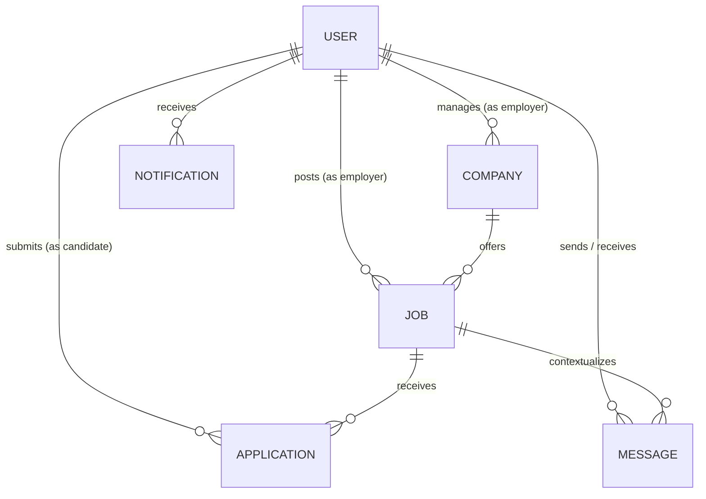

# CareerConnect — Database Schema & Data Dictionary

This document specifies the MongoDB database design, Mongoose schemas, relationships, and indexing strategies for **CareerConnect**.

---

## 1. Entity-Relationship Model Overview

---

## 2. Collections & Schema Specifications

### 2.1. `users` Collection
Represents system actors across three distinct roles: `candidate`, `employer`, and `admin`.

| Field Name | Type | Validation / Constraints | Description |
|---|---|---|---|
| `_id` | ObjectId | Auto-generated PK | Unique identifier |
| `name` | String | Required, Trimmed | Full name of the user |
| `email` | String | Required, Unique, Lowercase, Trimmed | User's primary login identifier |
| `password` | String | Required, `select: false` | Salted and hashed using `bcryptjs` (salt rounds: 10) |
| `role` | String | Enum: `['candidate', 'employer', 'admin']` | Role-based authorization gate |
| `title` | String | Trimmed | Professional headline (e.g. "Senior React Engineer") |
| `bio` | String | Trimmed | Personal statement or summary |
| `avatar` | String | URL String | Profile avatar image link |
| `phone` | String | Trimmed | Contact telephone number |
| `location` | String | Trimmed | City/State/Country location |
| `skills` | [String] | Array of strings | Candidate skill tags |
| `experienceYears` | Number | Default: 0 | Total years of relevant professional experience |
| `resumeUrl` | String | URL / Relative path | Path to uploaded resume file (`/uploads/...`) |
| `resumeOriginalName`| String | File name | Original uploaded filename |
| `companyId` | ObjectId | Ref: `'Company'` | Associated company (for employers) |
| `status` | String | Enum: `['active', 'banned']`, Default: `'active'` | Moderation status for admin control |
| `resetPasswordToken`| String | Hex string | Hashed token for password resets |
| `resetPasswordExpire`| Date | Timestamp | Expiration timestamp for reset token |
| `createdAt` | Date | Auto-timestamp | Creation timestamp |
| `updatedAt` | Date | Auto-timestamp | Last update timestamp |

**Indexes:**
- `{ email: 1 }` (Unique)
- `{ role: 1 }`
- `{ status: 1 }`

---

### 2.2. `companies` Collection
Represents verified employing organizations on the platform.

| Field Name | Type | Validation / Constraints | Description |
|---|---|---|---|
| `_id` | ObjectId | Auto-generated PK | Unique company identifier |
| `name` | String | Required, Trimmed | Official registered corporate name |
| `logoUrl` | String | URL String | Corporate badge or brand logo |
| `bannerUrl` | String | URL String | Header showcase banner image |
| `website` | String | URL String | Public website link |
| `location` | String | Required | Corporate headquarters city/country |
| `industry` | String | Required | Sector (e.g. "Cloud Infrastructure", "FinTech") |
| `size` | String | Enum: `['1-10', '11-50', '51-200', '201-500', '501-1000', '1000+']` | Workforce size band |
| `description` | String | Required | Comprehensive company overview |
| `culture` | String | Text | Work environment and values |
| `benefits` | [String] | Array of strings | Perks & compensation highlights |
| `employerId` | ObjectId | Ref: `'User'` | Employer user account managing this organization |
| `status` | String | Enum: `['active', 'flagged']`, Default: `'active'` | Moderation status |
| `flagReason` | String | Optional | Notes if flagged by admin |
| `createdAt` | Date | Auto-timestamp | Timestamp created |
| `updatedAt` | Date | Auto-timestamp | Timestamp modified |

---

### 2.3. `jobs` Collection
Represents employment listings published by recruiters and employers.

| Field Name | Type | Validation / Constraints | Description |
|---|---|---|---|
| `_id` | ObjectId | Auto-generated PK | Unique job posting ID |
| `title` | String | Required, Trimmed | Job title |
| `companyId` | ObjectId | Required, Ref: `'Company'` | Organization hiring for the role |
| `postedBy` | ObjectId | Required, Ref: `'User'` | Recruiter user who authored the listing |
| `description` | String | Required | Detailed job role overview |
| `responsibilities`| [String]| Array of strings | Core daily responsibilities |
| `requirements` | [String] | Array of strings | Required qualifications and experience |
| `jobType` | String | Enum: `['Full-Time', 'Part-Time', 'Contract', 'Internship']` | Engagement category |
| `experienceLevel`| String | Enum: `['Entry Level', 'Mid Level', 'Senior Level', 'Lead / Principal']` | Seniority tier |
| `workplaceType` | String | Enum: `['On-site', 'Hybrid', 'Remote']` | Physical arrangement |
| `category` | String | Required | Taxonomy category (e.g. "Design", "Development") |
| `salaryMin` | Number | Positive number | Minimum compensation range |
| `salaryMax` | Number | Positive number | Maximum compensation range |
| `salaryCurrency`| String | Default: `'USD'` | Currency code (USD, EUR, GBP, INR) |
| `location` | String | Required | Geographical workplace location |
| `skillsRequired`| [String] | Array of strings | Tagged skills for search matching |
| `featured` | Boolean | Default: `false` | Promoted listing flag |
| `status` | String | Enum: `['Active', 'Closed', 'Draft']`, Default: `'Active'` | Lifecycle state |
| `createdAt` | Date | Auto-timestamp | Date posted |
| `updatedAt` | Date | Auto-timestamp | Date modified |

**Indexes:**
- `{ title: 'text', description: 'text', skillsRequired: 'text' }` (Full-Text Search Index)
- `{ category: 1 }`
- `{ jobType: 1 }`
- `{ status: 1 }`
- `{ featured: 1 }`
- `{ createdAt: -1 }`

---

### 2.4. `applications` Collection
Captures candidate submissions to open jobs.

| Field Name | Type | Validation / Constraints | Description |
|---|---|---|---|
| `_id` | ObjectId | Auto-generated PK | Unique application ID |
| `jobId` | ObjectId | Required, Ref: `'Job'` | Position applied for |
| `candidateId` | ObjectId | Required, Ref: `'User'` | Candidate submitting application |
| `resumeUrl` | String | Required | Document location of candidate resume |
| `coverNote` | String | Text | Introductory cover pitch or statement |
| `portfolioUrl` | String | URL String | External portfolio/GitHub link |
| `status` | String | Enum: `['Submitted', 'Reviewed', 'Shortlisted', 'Interview', 'Rejected', 'Hired']` | Workflow stage (Default: `'Submitted'`) |
| `feedbackNote`| String | Text | Optional employer notes / feedback |
| `statusUpdatedAt`| Date | Timestamp | Date of latest status change |
| `createdAt` | Date | Auto-timestamp | Application submission time |
| `updatedAt` | Date | Auto-timestamp | Record modification time |

**Compound Indexes & Integrity Constraints:**
- `{ jobId: 1, candidateId: 1 }` (Unique compound index ensuring duplicate applications are rejected at the database level).
- `{ candidateId: 1, createdAt: -1 }`
- `{ jobId: 1, status: 1 }`

---

### 2.5. `messages` Collection
Represents direct real-time communication between recruiters and candidates.

| Field Name | Type | Validation / Constraints | Description |
|---|---|---|---|
| `_id` | ObjectId | Auto-generated PK | Unique message identifier |
| `senderId` | ObjectId | Required, Ref: `'User'` | Message originator |
| `receiverId` | ObjectId | Required, Ref: `'User'` | Message destination |
| `jobId` | ObjectId | Ref: `'Job'` | Optional contextual job posting |
| `messageText`| String | Required | Text payload |
| `attachmentUrl`| String | Optional | Uploaded attachment path |
| `attachmentName`| String| Optional | Original file name |
| `attachmentSize`| String| Optional | Formatted file size string |
| `read` | Boolean | Default: `false` | Read receipt flag |
| `timestamp` | Date | Default: `Date.now` | Sent timestamp |

**Indexes:**
- `{ senderId: 1, receiverId: 1, timestamp: -1 }`
- `{ receiverId: 1, read: 1 }`

---

### 2.6. `notifications` Collection
In-app and real-time alert notifications.

| Field Name | Type | Validation / Constraints | Description |
|---|---|---|---|
| `_id` | ObjectId | Auto-generated PK | Unique notification identifier |
| `recipientId` | ObjectId | Required, Ref: `'User'` | User receiving alert |
| `type` | String | Enum: `['application_status', 'new_application', 'new_message', 'system']` | Notification taxonomy |
| `title` | String | Required | Alert title |
| `message` | String | Required | Human-readable notification body |
| `link` | String | Optional | Navigation target URI |
| `read` | Boolean | Default: `false` | Read status |
| `createdAt` | Date | Auto-timestamp | Notification time |

---

### 2.7. `taxonomies` Collection
Platform-wide dynamic categories and skill tags maintained by system administrators.

| Field Name | Type | Validation / Constraints | Description |
|---|---|---|---|
| `_id` | ObjectId | Auto-generated PK | Unique taxonomy identifier |
| `name` | String | Required, Trimmed | Tag or category label |
| `type` | String | Enum: `['category', 'tag']`, Default: `'tag'` | Classification |
| `icon` | String | Optional | Icon key identifier |
| `createdAt` | Date | Auto-timestamp | Timestamp created |

**Indexes:**
- `{ name: 1, type: 1 }` (Unique compound index)

